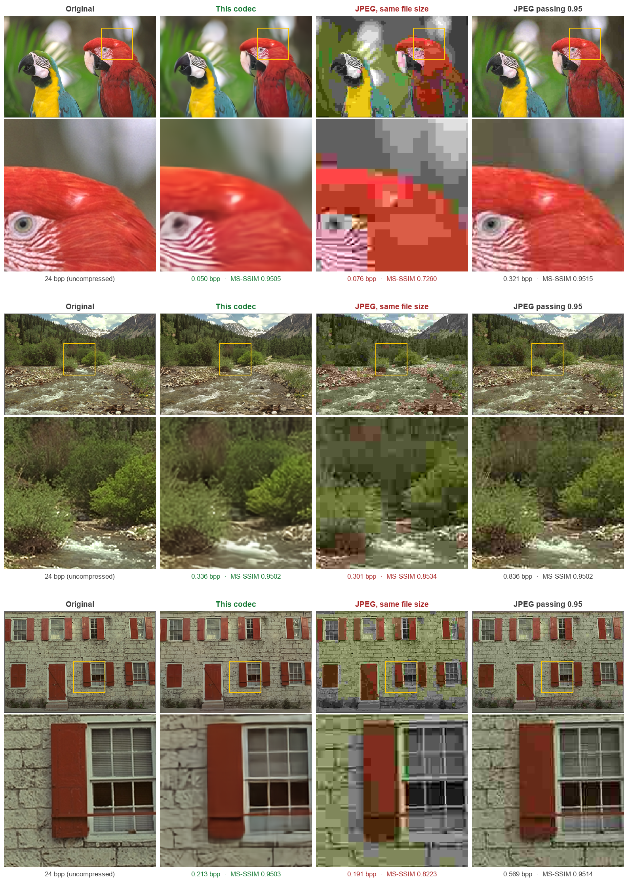

# Learned Image Compression (MS-SSIM ≥ 0.95 challenge)

An end-to-end learned image codec trained from scratch on DIV2K (800 train HR images only, no
pretrained weights, no external data).

## Run

```bash
pip install -r requirements.txt          # Python 3.12
python compress.py   input_dir  compressed_dir
python decompress.py compressed_dir  output_dir
python evaluate.py --originals input_dir --compressed compressed_dir --reconstructed output_dir
```

`weights/codec.pt` (about 55 MB) holds every learned parameter. A GPU is used when available. Decoding
also works on CPU only, and the bitstreams decode identically on any machine (see below).

## Results

| Test set | Avg bpp | Lowest MS-SSIM | Gate |
|---|---|---|---|
| Kodak (24 images, 768×512) | **0.1324** | 0.9501 | passed |
| DIV2K valid, 10 unseen 2K images | 0.092 | 0.9501 | passed |
| JPEG, per-image best quality (Kodak, reference) | 0.481 | ≥ 0.95 | passed |



Kodak 23, 13 and 1. Yellow box = zoomed crop below. Regenerate with
`python tools/make_figure.py data/kodak <compressed_dir> <reconstructed_dir> docs/comparison.png kodim23:490,60 kodim13:300,150 kodim01:350,250`.

## Method

- **Transform**: ELIC-style analysis and synthesis networks, with strided 5×5 convolutions and
  residual bottleneck blocks, 192 channels. The latent has 320 channels at 1/16 resolution.
- **Entropy model**: mean-scale Gaussian conditional with three context sources:
  - a hyperprior with 192 channels at 1/64 resolution and a learned factorized density;
  - channel-wise autoregressive context over uneven slices `[16, 16, 32, 64, 192]`;
  - checkerboard spatial context inside each slice.
- **Variable rate in one model**: learned per-channel gain and inverse-gain vectors for 8 rate
  levels, λ from 0.25 to 24. They are interpolated into 256 fine levels at deploy time.
- **Training loss**: `bpp + λ · (1 − MS-SSIM)`. λ is sampled per image, and the MS-SSIM is a
  differentiable port of the evaluation script's metric.
- **Per-image rate control**: the encoder binary-searches the 256 levels for the smallest level
  whose decoded image still reaches MS-SSIM ≥ 0.95. It checks this with the exact decoder path,
  so every image passes the gate with minimal bytes.
- **Deterministic entropy coding**: the hyper-synthesis and context networks run in exact
  fixed-point integer arithmetic at deploy time. The scale index, means and probability tables are
  then bit-identical on encoder and decoder, whatever the CPU, GPU or BLAS. Range coding uses
  `constriction`.
- **Bitstream**: 5-byte header (level, height, width), then the range-coded hyper-latent and latent.

## Training (reproduce the weights)

Single RTX 5060 Ti, about 15 hours in total. Commands, in the order they were run:

```bash
python tools/prepare_data.py data/DIV2K_train_HR data/div2k_npy   # DIV2K train at scales 1, .75, .5, .35

# Steps 1-2 used LAMBDAS = 1.5..64 in imgcomp/model.py; the file now holds the final 0.25..24 range.
# 1) 0-16k steps: base model (channel context only), lambda range 1.5..64
python train.py --out runs/main --steps 400000
# 2) 16k-20k: add the checkerboard spatial context (zero-initialised, warm start)
python train.py --out runs/main --steps 400000 --resume runs/main/A_step16000.pt --reset-opt
# 3) 20k: re-target the rate levels to lambda 0.25..24 (easy images needed lower rates)
python tools/remap_levels.py runs/main/B_step20000.pt runs/main/C_step20000.pt 1.5 64
python train.py --out runs/main --steps 400000 --resume runs/main/C_step20000.pt --reset-opt
# 4) 184k-260k: learning-rate decay (1e-5, then 1e-6 from 239k)
python train.py --out runs/main --steps 260000 --decay-at 0.7 0.92 --resume runs/main/C_step184000.pt
# 5) 260k-340k: finetune on 512x512 crops (MS-SSIM's coarse scales then see more context)
python train.py --out runs/ft --resume runs/main/last.pt --reset-opt --steps 280000 --lr 1e-5 --decay-at --crop 512 --batch 4
python train.py --out runs/ft2 --resume runs/ft/last.pt --steps 340000 --lr 1e-5 --decay-at 0.9 --crop 512 --batch 4

python tools/export.py runs/ft2/last.pt weights/codec.pt
```

Training data: only `DIV2K_train_HR`. Kodak is used only to monitor progress during training (no
gradient ever comes from it).
